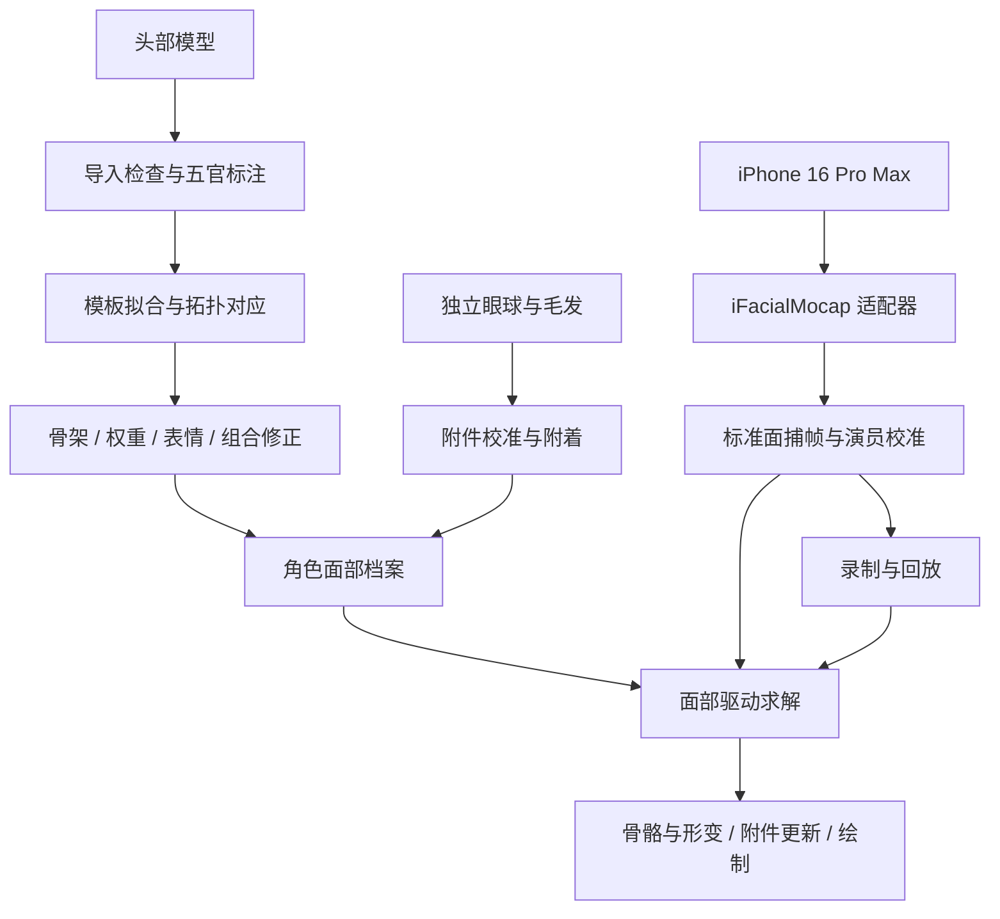

# AI 模块化角色头部绑定与 iPhone 面捕开发方案

日期：2026-10-27  
状态：开发设计，尚未实施；本文不代表功能已完成或真机验收通过。  
指定采集设备：用户现有的 **iPhone 16 Pro Max**。  
首选路线：**iFacialMocap 实时采集 → 引擎接收与归一化 → ARKit 52 路语义通道 → 角色校准 → 骨骼、表情形变与组合修正**。

## 1. 目标与结论

开发一个允许头部、身体、眼球和毛发分别导入的角色系统。当前优先完成头部：用户导入没有面部绑定的头部模型，由 AI 辅助识别五官和区域，结合标准模板、几何拟合与约束求解，生成可编辑的头部骨架、蒙皮权重、表情形变和校准配置，再由手机面捕驱动。

系统应让不同角色共用稳定的骨骼语义和表情通道，允许外部面捕来源替换，允许眼球和毛发单独更换，并将生成结果保存为可复用的角色头部资产。

技术路线可行，但交付承诺是“在声明的模型范围内自动完成初始绑定，并提供质量诊断与人工校准”，不能承诺任意拓扑、任意生物或任意缺失结构的模型都能一键获得影视级表现。

核心原则：

1. 骨骼名称、层级、坐标轴、绑定姿态和模板版本共同构成标准；仅统一名称不足以实现动作兼容。
2. 面捕统一在表情语义层，避免让外部设备直接依赖角色骨骼索引。
3. 52 路输入、骨骼数量和形变目标数量是三个独立维度，不要求一一对应。
4. 初版使用骨骼、表情形变和组合修正；解剖肌肉与全脸软体模拟属于后续研究。
5. 先打通“已有合格绑定头部 + 手机”的实时链路，再开发自动绑定，分别定位采集和绑定问题。

## 2. 设备与面捕方案

### 2.1 iPhone 16 Pro Max 的适用性

Apple 官方规格列有 TrueDepth 前置摄像头和 Face ID，具备本方案所需的硬件基础；无需为初版另购手机。Epic 的 MetaHuman Animator 设备要求覆盖 iPhone 12 及更新设备。[Apple 设备规格](https://support.apple.com/en-gb/121032)、[Epic 采集设备要求](https://dev.epicgames.com/documentation/metahuman/metahuman-animator-capture-device-requirements)

硬件满足条件不等于已在本项目中实测。实施时必须记录 iOS、采集 App 版本、发送协议版本、电脑网络条件和持续运行结果。面捕使用前置摄像头，不能把后置 LiDAR、屏幕刷新率或视频录制帧率当作面捕精度和输出帧率的保证。

### 2.2 方案选择

| 路线 | 项目中的用途 | 决策 |
| --- | --- | --- |
| iFacialMocap | 通过公开接口直接向自研引擎提供实时表情、头部和眼睛数据 | 首选集成路线 |
| Live Link Face 的 ARKit 工作流 | 体验、对照采集与后续输入适配 | 第二适配器；需单独确认协议和使用条款 |
| Live Link Face + MetaHuman Animator | 在 Epic 工作流中进行实时或离线表演制作 | 作为外部质量参考，不作为引擎运行依赖 |
| 自研 ARKit iOS App | 自定义时间戳、连接、录制、设备状态与校准体验 | 成熟后评估，首版不依赖 |

iFacialMocap 官方公开了第三方接收接口，可不经过其电脑中转软件。接收器应按明确的协议版本实现，不将网上的单个示例当作完整协议。[官方通信说明](https://www.ifacialmocap.com/for-developer/)

Live Link Face 的 ARKit 与 MetaHuman Animator 工作流需要分别处理，不能假定它们的数据格式或输出通道完全相同。Epic 提供了面向 Unreal 的采集与连接说明。[ARKit 工作流](https://dev.epicgames.com/documentation/en-us/unreal-engine/recording-face-animation-on-ios-device-in-unreal-engine)、[iOS 安装与 Animator 设置](https://dev.epicgames.com/documentation/metahuman/installing-live-link-face-on-ios)

应用价格、地区上架情况与版本要求以实施时的官方页面和用户所在地区 App Store 为准，本文不锁定价格。

### 2.3 用户首次连接步骤

1. 在 iPhone 16 Pro Max 安装 iFacialMocap，允许摄像头和本地网络权限；实际菜单以安装版本为准。
2. 电脑尽量通过网线连接路由器，手机接入同一路由器的稳定 Wi-Fi；避免使用隔离客户端的访客网络。
3. 编辑器显示电脑的可用局域网地址、接收端口和连接状态；用户在手机中填写对应地址，或由适配器按协议发起连接。
4. 配置手机地址、发送版本和端口。仅在需要时允许 Windows 专用网络对应端口，不关闭整个防火墙。
5. 用实时通道面板确认闭左眼、闭右眼、张嘴和左右转头的数据方向，再加载角色。
6. 手机固定在眼睛附近高度，初始距离建议约 35–60 cm，以 App 能稳定识别人脸为准；使用均匀柔光，避免遮挡和强逆光。
7. 采集中性表情，再逐项采集舒适范围的最大动作，保存为演员校准档案。
8. 录制一段 30–60 秒测试，检查跟踪中断、左右方向、音画参考和回放；之后再做持续运行验收。

USB-C 充电连接不等于已有数据网络通道。首版使用局域网；有线网络、USB 网络或其他传输方式需要独立验证。头戴支架属于后续移动表演扩展，桌面固定支架足够开始研发。

## 3. 工程现状与前置依赖

本节基于本次工作区读取，属于静态核对，不是重新运行后的测试结论。

| 项目 | 当前证据 | 本方案需要的工作 |
| --- | --- | --- |
| 角色导入与归一化 | `engine/assets/character-source.mjs` 已处理角色网格、骨架及形变合并 | 增加头部部件、语义和绑定结果导入 |
| 形变导入预算 | 上述文件限制每网格和合并结果最多 16 个形变目标 | 增加版本化预算与内存校验 |
| 原生动画容量 | `engine/native/animation.hpp` 定义 256 bones、32 curves、16 morph targets，morph 占曲线 16–31 槽 | 独立面部缓冲或可扩展曲线布局，避免侵占现有通道 |
| 形变插值掩码 | `stepMorphMask` 为 `uint16_t`；加载器使用与目标数有关的移位 | 改为可扩展位集合或逐目标标志，审计移位溢出 |
| 动画加载 | `engine/native/animation_asset.cpp` 校验并加载形变及片段 | 增加新格式，明确旧格式兼容策略 |
| 肌肉与软组织 | 现有动画说明记录规则肌肉和局部软组织基础 | 不能直接视作面部肌肉解算已完成 |
| 毛发系统 | 已有独立毛发方案与部分实现 | 分别核对数据附着、原生绘制和模拟；不能用文件存在证明完整可用 |
| 面部系统 | 现有动画说明将 M5 面部列为未实现 | 新增面部资产、求解、校准、编辑器与采集链路 |

参考：[外部资产支持范围](../assets/EXTERNAL-ASSETS.md)、[动作系统说明](ANIMATION.md)、[M1–M4](ANIMATION-M1-M4.md)、[毛发与服装权重方案](AI-HAIR-GENERATOR-AND-GARMENT-WEIGHTS-PLAN.md)。历史动画文档包含旧导入边界；实施时以当前代码与对应专项证据为准。

扩大形变数量必须贯通导入、二进制布局、CPU/GPU 缓冲、着色器循环、插值标志、动画混合、存档、回放、哈希、热重载、编辑器传输及打包。禁止只把常量 16 改成 52 后宣称完成。

## 4. 支持范围与输入规范

### 4.1 首版支持

- 中性表情、接近人类结构的独立头部，包括写实与适度风格化模型。
- 头部无骨架，或用户明确选择重新绑定；已有绑定可走保留与映射模式。
- 眼球可单独导入，也可在头部导入后添加；没有眼球时允许完成部分绑定，但不能通过完整眼部验收。
- 头发、眉毛、睫毛、胡须为独立附件；首版允许网格或发片，曲线发丝使用单独适配能力位。
- 优先 GLB/glTF；其他格式复用现有转换入口并输出转换诊断，不在本方案中承诺未经测试的格式。

### 4.2 输入检查

| 检查 | 处理方式 |
| --- | --- |
| 单位、上下方向、脸部朝向 | 导入预览确认，使用现有统一坐标转换，避免重复镜像 |
| 中性表情 | 检测张嘴、眯眼等偏差；无法可靠判断时要求人工确认 |
| 退化面、非流形、自交、重复壳层 | 列出位置与严重性；影响拟合时阻止发布 |
| 嘴唇和上下眼睑是否可分离 | 检查拓扑与空间结构；焊死的嘴或眼不能靠权重凭空打开 |
| 口腔、牙齿、舌头缺失 | 标记缺失能力；补建只在用户选择后作为新派生资产生成 |
| UV、材质和接缝 | 保留源属性；重拓扑需要显式生成转移映射与烘焙产物 |
| 非对称与特殊比例 | 允许声明非对称，禁止无提示强制镜像 |
| 顶点、三角形、部件和骨骼预算 | 预检后明确拒绝超限，不静默删减 |

AI 不得无提示改变角色身份、比例、拓扑、UV 或源文件。所有清理、补口腔、重拓扑和纹理转移保存在派生版本中，支持撤销及源资产重导入。

### 4.3 后续支持

极度夸张脸型、非人脸、多眼、多嘴、写实舌头细节、完整口腔接触求解、面部 FEM 肌肉、皮肤滑移与影视级皱纹均为扩展范围，需要独立模板和验收，不能默认套用人形模板。

## 5. 系统架构与职责



职责分为五层：

1. **离线头部构建器**：生成并验证绑定资产，可耗时较长，不进入实时帧循环。
2. **采集适配器**：只解释外部协议，输出统一数据，不直接改角色网格或场景文件。
3. **面部求解器**：将标准通道转换成角色专属的骨骼和形变。
4. **角色装配器**：管理身体、头部与附件的实例、共享资源和更新顺序。
5. **编辑器与诊断**：提供校准、修正、质量视图、录制和可复现证据。

## 6. 标准骨架模板

### 6.1 命名与版本

拟定模板 ID 为 `native.face.human.v1`，独立于外部软件命名。小写 snake_case，左右后缀 `_l` / `_r` 始终按角色自身左右，不能按屏幕左右解释。

语义 ID 与名称分开保存。实际骨骼索引允许因资产编译而变化，引用必须通过稳定语义 ID 解析。模板清单应冻结所有名称、父级、语义、默认轴向、可编辑范围和可选能力；新增骨骼必须升级模板版本或使用声明过的扩展配置，不能在不同角色间随意省略后重排索引。

### 6.2 v1 骨架分组

下表为拟议规范。`{l,r}`、`{01..03}` 表示构建模板时展开为固定名称；提交模板清单时不得保留模式字符串。

| 分组 | 名称或展开规则 | 约束 |
| --- | --- | --- |
| 连接 | `head_attach` → `head` → `face_root` | `head_attach` 为头身接口，面部驱动不能改身体根运动 |
| 下颌 | `jaw` | 位于 `face_root` 下；固定旋转枢轴和张合范围 |
| 眼球 | `eye_l`、`eye_r` | 位于 `face_root` 下；中心来自实际眼球校准 |
| 舌头 | `tongue_01` → `tongue_02` → `tongue_03` | 挂在 `jaw` 下，缺舌头网格时声明未绑定能力 |
| 上眼睑 | `lid_upper_{l,r}_{01..03}` | 位于 `face_root` 下，围绕眼球表面求闭合 |
| 下眼睑 | `lid_lower_{l,r}_{01..03}` | 不作为眼球骨骼直接子级，避免视线转动带动整片眼皮 |
| 眉毛区域 | `brow_inner_{l,r}`、`brow_mid_{l,r}`、`brow_outer_{l,r}` | 分区控制抬眉、压眉与不对称 |
| 嘴唇中心 | `lip_upper_mid`、`lip_lower_mid` | 父级为 `face_root`，下颌跟随由求解器计算一次 |
| 嘴唇侧段 | `lip_upper_{l,r}_{01..03}`、`lip_lower_{l,r}_{01..03}` | 兼顾闭唇、噘嘴和横向拉伸 |
| 嘴角 | `lip_corner_l`、`lip_corner_r` | 明确微笑、下压和外拉的局部方向 |
| 面颊 | `cheek_upper_{l,r}`、`cheek_lower_{l,r}` | 体积修正与鼓腮 |
| 鼻部 | `nose_bridge`、`nose_tip`、`nose_ala_l`、`nose_ala_r` | 不把鼻翼误识别成嘴唇区域 |
| 下巴 | `chin_mid`、`chin_l`、`chin_r` | 与下颌及下唇分区协调 |

首版先冻结基础清单；高级模板可以增加口轮匝区域控制、鼻唇沟或更多眼睑段，但运行时必须遵守骨骼预算。表面控制骨不等同于真实解剖骨或真实肌肉。

### 6.3 坐标与绑定规范

- 单位统一为米，归一化后沿用引擎坐标约定；当前 `engine/assets/coordinates.mjs` 注释声明角色正面为 `-Z`，不得凭外部工具默认方向再镜像一次。
- 每根骨骼保存局部绑定 TRS、全局绑定变换、逆绑定矩阵和约束参考框架。
- 下颌定义开合轴和滑移方向；眼球定义中心、注视前向与转动限制；眼睑定义沿眼球表面的闭合路径。
- 导入外部骨架时通过别名映射到语义 ID，保留原名用于诊断；同名但层级或轴向不同的骨骼不能判定为直接兼容。
- 第一版沿用正均匀缩放和现有蒙皮约束；镜像、剪切及非均匀缩放按资产链路规则处理。

## 7. ARKit 52 路标准表情通道

采用 Apple ARKit 表情名称作为 v1 输入语义。它描述面部动作系数，不要求角色有 52 根骨骼或 52 个同名形变。[Apple 表情通道定义](https://developer.apple.com/documentation/arkit/arfaceanchor/blendshapelocation)

### 7.1 固定名称清单

```text
browDownLeft
browDownRight
browInnerUp
browOuterUpLeft
browOuterUpRight
cheekPuff
cheekSquintLeft
cheekSquintRight
eyeBlinkLeft
eyeBlinkRight
eyeLookDownLeft
eyeLookDownRight
eyeLookInLeft
eyeLookInRight
eyeLookOutLeft
eyeLookOutRight
eyeLookUpLeft
eyeLookUpRight
eyeSquintLeft
eyeSquintRight
eyeWideLeft
eyeWideRight
jawForward
jawLeft
jawOpen
jawRight
mouthClose
mouthDimpleLeft
mouthDimpleRight
mouthFrownLeft
mouthFrownRight
mouthFunnel
mouthLeft
mouthLowerDownLeft
mouthLowerDownRight
mouthPressLeft
mouthPressRight
mouthPucker
mouthRight
mouthRollLower
mouthRollUpper
mouthShrugLower
mouthShrugUpper
mouthSmileLeft
mouthSmileRight
mouthStretchLeft
mouthStretchRight
mouthUpperUpLeft
mouthUpperUpRight
noseSneerLeft
noseSneerRight
tongueOut
```

数组存储顺序由 schema 冻结并记录版本，不能依赖外部数据包的字段顺序。外部的 `mouthSmile_L` 等别名通过适配表转为规范名称；缺失、未知和无效字段分别报告。

### 7.2 映射规则

| 输入 | 骨骼输出示例 | 形变或约束 |
| --- | --- | --- |
| `jawOpen` | 下颌旋转和有限滑移 | 下巴体积、嘴角与口腔修正 |
| `mouthSmileLeft/Right` | 对应嘴角和面颊运动 | 鼻唇沟与嘴唇轮廓修正 |
| `eyeBlinkLeft/Right` | 上下眼睑闭合 | 与眼球曲率匹配，避免穿透 |
| `mouthPucker`、`mouthFunnel` | 唇环收缩与前移 | 两种动作分开制作和组合 |
| `mouthClose` | 控制唇间接触 | 不直接把下颌角强制归零 |
| `eyeLook*` | 眼球转动的一个来源 | 与直接眼球姿态二选一或明确融合 |
| `tongueOut` | 舌链伸展 | 无舌网格时标记不支持，不能伪造成功 |

眼球姿态和 `eyeLook*` 不能重复叠加。`jawOpen` 与 `mouthClose`、眨眼与睁眼等组合通过角色驱动图和接触规则求解，不简单互相相减或全部叠满。

## 8. AI 自动绑定流程

### 8.1 识别与人工确认

输入几何与多视角渲染，识别眼角、上下眼睑、嘴角、上下唇缘、鼻翼、下巴和头皮区域。图像标注必须回投到实际网格，并记录三角形 ID、重心坐标、置信度及误差，不能只保存屏幕像素。

侧面、遮挡和非对称区域需要几何检查。低置信度、关键点缺失或左右不一致时进入“待校准”，在编辑器中允许拖动标点与区域边界，保留用户锁定的标注。

### 8.2 模板拟合与两种拓扑模式

先做尺度与刚体对齐，再进行保持局部形状的非刚性拟合；约束眼裂、唇线、鼻翼、下颌和头身连接边界，惩罚折叠、自交与不合理局部缩放。

| 模式 | 方法 | 边界 |
| --- | --- | --- |
| 保留原拓扑 | 模板到源网格建立表面对应，转移骨骼、权重和形变 | 初版优先；源拓扑不足时质量受限 |
| 生成标准拓扑 | 将标准拓扑拟合到原模型，转移纹理和属性 | 生成新资产；不得无提示替换源网格与 UV |

模板表面对应必须使用区域标签限制，避免最近点把上唇映射到下唇、把眼睑映射到眼球。张嘴或闭眼测试失败时不能仅靠增加权重平滑掩盖错误。

### 8.3 骨架与蒙皮

根据拟合后的模板生成关节位置、局部轴和约束。使用区域限制的权重转移与平滑，固定头皮和颅骨区域，隔离上下唇与左右眼睑；鼻部和面颊设置合理过渡。

当前引擎每顶点最多四个权重。首版继续遵守，保存截断前后误差；需要更多权重时另立渲染扩展，不能静默丢失高影响骨骼。所有权重必须非负、有限、归一化，锁定区域在重算时保持不变。

### 8.4 表情与组合修正生成

模板必须包含经过制作和质量审核的基础表情，AI 将其适配到新头型，再使用几何约束和修正工具调整。单个中性头部并不能唯一决定笑容、皱纹、内部肌肉或缺失的口腔；没有模板内容和质量样本时，只能生成初始近似结果。

优先处理闭眼、张嘴、闭唇、微笑、噘嘴、压眉与鼓腮。使用姿态驱动修正处理张嘴加微笑、抬眼加闭眼、噘嘴加下颌运动。修正目标保存触发条件和适用空间，避免与骨骼驱动重复施加同一种形变。

### 8.5 AI 能力的实际落地

AI 模块以可替换接口接入，不在本文指定尚未评估的模型为已选定依赖。实施前比较：关键点识别精度、三维区域分割、风格化脸泛化、离线能力、显存、耗时和授权条件。

需要合法可用的模板网格、绑定、表情库、眼球样例和评测头部。先建立可人工标注运行的几何基线，再接 AI 提升自动化，确保模型不可用时仍能完成工作。生成时记录模型/权重版本、配置、模板哈希、源哈希、随机种子和人工修订；只有固定已生成产物的重复烹制要求字节与哈希稳定，不要求不同 GPU 上的 AI 推理天然完全确定。

首版不自动训练新的基础模型。若现有模型不能达到准入标准，单独制定数据集、训练成本和授权方案。未经用户选择，不将头部模型或采集数据发送到外部服务。

## 9. 肌肉、皮肤与更新顺序

### 9.1 分层实现

| 层 | 内容 | 阶段 |
| --- | --- | --- |
| 刚体与骨骼 | 头部、下颌、眼球、舌头及面部控制骨 | 初版 |
| 皮肤表情 | 基础形变、体积保持、唇线和眼睑修正 | 初版 |
| 姿态组合 | 多表情组合的校正目标与接触约束 | 初版逐步补齐 |
| 表面细节 | 皱纹法线/位移、区域遮罩与材质响应 | 质量增强 |
| 生理模拟 | 解剖肌肉、皮肤滑移、完整软组织与接触 | 后续研究 |

控制骨、程序化“肌肉”形变和真实生理模拟必须在能力标识中区分，不混用完成状态。

### 9.2 固定求值顺序

1. 身体动画确定颈部和头部基准。
2. 采集帧按接收时间排队并重采样至动画 tick。
3. 演员校准、滤波和角色驱动图计算标准通道。
4. 求解头部姿态、下颌、眼球和面部控制骨，明确身体与面捕的混合权重。
5. 在声明的空间生成表情与组合修正：局部网格形变先于蒙皮；后蒙皮修正必须显式标识。
6. 蒙皮、必要的局部软组织、法线与切线更新。
7. 依赖变形表面的眉毛、睫毛、胡须及头皮附着点更新，然后执行已有能力范围内的毛发模拟和绘制。

不得由面捕头部位移直接推动角色胶囊或身体根运动。脸部局部形变、后蒙皮修正和软组织位移各施加一次，并纳入诊断。

## 10. 独立部件装配

### 10.1 眼球

校准左右身份、中心、半径或拟合代理、瞳孔前向、绑定变换和转动范围。椭球或非球形眼需要声明自定义接触代理，不能用材质高光位置推断旋转轴。

眼睑应沿眼球表面闭合并保持合理厚度，验证上下看时的眨眼。更换眼球后，如果中心、尺寸或朝向改变，重新生成眼睑接触与闭合校正，并使依赖校准失效，不能只替换贴图继续沿用旧数据。

### 10.2 毛发、眉毛、睫毛和胡须

- 头发根部使用头皮三角形与重心坐标、局部偏移和拓扑哈希；远端可交给现有毛发模拟能力。
- 眉毛绑定眉区变形表面，睫毛绑定对应眼睑表面，胡须绑定上唇、下巴或面颊。
- 普通发型整体随头运动即可开始；高质量表面附着、动态碰撞和发丝绘制按现有能力逐项接通。
- 换发型不应重算面部骨架；头部拓扑变化则必须重建或验证所有表面附着映射。
- 缺失的原生发丝绘制能力明确报告，不能用占位图或头皮锚点验收替代实际毛发效果。

### 10.3 牙齿与舌头

上牙跟随头部，下牙跟随下颌，舌头由独立链控制。牙齿和口腔缺失时可预览外部表情，但必须将“完整张嘴表现”标记为不通过。牙齿位置、咬合与唇间接触分别校准。

### 10.4 头身连接

定义版本化 `headSocket`：颈部参考骨、连接平面、尺度范围、边界环对应和权重过渡。装配后共用骨架或通过头部独立调色板接收身体锚点，首版优先独立头部实例以隔离预算。

不能只将两个网格的位置对齐；需处理颈部接缝、法线、材质过渡和运动中的权重连续性。连接不兼容时提示重新适配，禁止无提示强制缩放整个头部。跨实例相同骨骼名称通过部件命名空间隔离。

## 11. 采集协议、数据与时序

### 11.1 适配器要求

iFacialMocap 的传统接口说明包含 UDP 接收端口 49983、以度为单位的欧拉角、0–100 的传统表情值，以及 v2 分隔方式；官方也提供 v3 入口。上述内容仅作为协议实现依据，具体按安装版本和官方样例验证，不混解不同版本。[官方协议及示例](https://www.ifacialmocap.com/for-developer/)

- 第一适配器优先明确选择并验证 v2；如果当前 App 不支持则采用已验证版本，记录协商结果。
- 绑定地址、手机地址、接收端口和协议版本可配置；不要同时运行两个竞争同一端口的接收程序。
- 接收线程只产生有界数据帧，主线程通过快照读取，禁止在渲染线程等待网络。
- 数据包长度、通道数量、字符串长度和数值范围均有上限。无效包丢弃并计数，不能传播 NaN 或无限值。
- 对直接接收、重连、断流、截断包、重复包和协议切换做独立测试。外部没有序号或时间戳时，不伪装成具备这些信息。
- TCP 作为后续选项单独实现缓冲与分帧；不能认为一次读取就是一帧，也不默认 TCP 能降低延迟。

### 11.2 统一采集帧（拟定内部契约）

```json
{
  "schema": "native.face.frame.v1",
  "sessionId": "session-example",
  "source": "ifacialmocap",
  "protocolVersion": "v2",
  "receiveSequence": 120,
  "sourceSequence": null,
  "sourceTimestampUs": null,
  "receiveTimestampUs": 2000000,
  "trackingStatus": "unknown",
  "channelLayout": "arkit52.v1",
  "channels": { "jawOpen": 0.4, "eyeBlinkLeft": 0.8 },
  "headLocalRotation": [0, 0, 0, 1],
  "headLocalTranslationMeters": [0, 0, 0],
  "eyeLocalRotations": null
}
```

这是字段示意，不是现有 API 或完整 52 路帧。完整帧必须包含通道有效位；缺失值不能与真实零值混淆。旋转内部采用归一化四元数 `[x,y,z,w]`，向量与角度经过显式坐标转换；姿态参考空间和转换版本写入会话元数据。

外部若不提供跟踪置信度、源时间戳或序号，对应字段为未知；允许记录“根据数据新鲜度推断”的状态，但必须标记来源，不能将其等同于设备人脸跟踪状态。接收序号只能衡量本地帧顺序，不能据此精确计算源端丢包率。

### 11.3 校准与滤波

演员校准与角色配置分开保存。演员档案记录中性偏移、舒适动作范围、左右差异、头部中性姿态；角色档案记录通道到绑定的响应。

可用的基础归一化为 `clamp((x - neutral) / max(range, epsilon), 0, 1)`，但范围过小的通道应标记校准失败而非放大噪声。标准输入以 0–1 为主；协议扩展中的负值或超范围保留原始记录并按显式规则转换，不静默套用传统范围。

使用时间相关滤波，可采用 One Euro 或等效低延迟方案；眨眼、嘴唇接触与慢速眉部运动分别调节，避免所有通道使用同样强平滑。用户可在原始、校准后、滤波后视图间比较。

### 11.4 断流与回放

拟定初始策略：数据年龄超过 100 ms 显示陈旧提示，超过 300 ms 开始在约 200 ms 内平滑回中性，超过 1 s 显示断开。数值是初始可调策略，需要实测后冻结；不因网络断开把眼球、下颌瞬间跳回零。

记录原始负载、接收时间、解析版本、标准帧、校准版本和驱动配置。实时网络不承诺确定性；回放在固定输入记录、固定重采样配置和固定构建下进入现有动画 tick，并校验摘要。旧协议无源时间戳时，只能保证接收时间轴的可复现性。

## 12. 角色标签与资产格式

“角色标签”在本方案中定义为可机器读取的面部能力和映射档案，不只是美术名称或情绪分类。

建议拆分：

| 文件（拟定） | 内容 |
| --- | --- |
| `head.json` | 头部资产 ID、网格/材质依赖和版本 |
| `face-rig.json` | 模板版本、骨骼语义、层级、绑定变换与约束 |
| `face-drivers.json` | 52 路映射、驱动图、组合修正及执行空间 |
| `face-capabilities.json` | 通道与部件支持状态、质量等级和未通过项 |
| `attachments.json` | 眼球、头皮、眉毛、睫毛、胡须和口腔装配 |
| `actor-calibration.json` | 演员设备和动作范围，独立于角色 |
| `build-manifest.json` | 源/模板/模型/配置/产物哈希与编译版本 |

所有引用使用项目内相对路径、稳定资产 ID 和内容哈希；拒绝路径越界、绝对外部依赖和缺失依赖发布。存档保存实例状态与版本引用，不复制全部静态网格。

资产状态机：`imported → annotated → fitted → rigged → calibrated → validated → published`。任何阶段失败保留前一可用版本和诊断。使用临时构建目录完成所有依赖后原子发布，失败不能产生半份可用资产。

能力状态至少包含 `supported`、`unsupported`、`needsCalibration`、`unmeasured`；存在字段或占位权重不表示动作已验收。模板、拓扑、眼球或驱动修改后，按依赖关系使校准和验收记录失效。

## 13. 预算与格式迁移

以下均为研发初始目标，尚无本机测量结果：

| 项目 | 初始目标 | 处理原则 |
| --- | --- | --- |
| 标准输入 | 52 路，布局可版本化 | 与形变目标数组分离 |
| 头部骨架 | 每个头部调色板不超过现有 256 节点上限 | 身体与头部合并时重新核算总数 |
| 形变容量 | 目标支持至少 52 基础目标及组合修正；建议首轮评估 128 个存储目标 | 不要求每帧全部激活；超限明确拒绝 |
| 每顶点影响 | 初版最多 4 | 记录权重截断误差 |
| 源网格顶点 | 先遵守现有角色 100000 顶点预算 | 拆分后按实例及总显存双重核对 |
| 手机输入速率 | 争取约 60 Hz，并正确处理 30 Hz、变频及断流 | 实测为准，不能按标称帧率验收 |
| 原生显示 | 目标 60 fps 的单头部预览 | 记录测试硬件、分辨率与场景负载 |
| PC 端面部求值 | 初始 CPU p95 ≤ 2 ms/头，GPU 变形新增 p95 ≤ 2 ms/头 | 不含网络与 AI 离线构建，超限需优化或调整质量档 |
| 端到端延迟 | 稳定局域网下初始目标 p95 ≤ 100 ms | 必须测实际脸部动作到屏幕，不能仅测接收器耗时 |

内存评估必须按实际布局计算。例如 100000 顶点、128 个稠密目标、每顶点位置和法线合计 24 字节，单份增量约 307200000 字节（约 293 MiB），尚未包含切线、对齐和多帧缓存。不能盲目扩容后超出蒙皮缓存。评估稀疏目标、区域压缩、活动目标列表和 GPU 预混合，最终根据精度与实测决定。

新资产格式升级版本；旧资产读取行为保持明确。重点审计 16 位掩码、32 位移位、固定数组、GPU 常量缓冲和曲线摘要。不得覆盖已有程序肌肉曲线或改变旧角色的默认表现。

## 14. 编辑器流程

增加“角色 → 头部与面捕”工作区，按依赖顺序引导：

1. **导入头部**：查看坐标、模型问题、缺失部件和预算。
2. **确认五官**：多视角标点、区域高亮、置信度、左右镜像辅助。
3. **生成绑定**：选择模板与拓扑模式，显示阶段、取消和失败原因。
4. **校准附件**：眼球中心、朝向、牙齿和毛发根部。
5. **测试表情**：逐通道滑条、预设动作、组合动作、权重热图和穿插视图。
6. **连接手机**：IP、端口、协议、帧龄、数据速率和跟踪状态来源。
7. **演员校准**：中性、闭眼、张嘴、微笑等引导与范围检查。
8. **录制和回放**：时间线、原始/处理后对照、断流标记和角色替换。
9. **发布头部资产**：显示能力清单、质量问题、依赖和版本差异。

所有编辑操作进入已有事务、撤销和重做体系。后台任务取消后清理临时文件，用户修改的标点和锁定权重不能被下一次 AI 生成直接覆盖。

## 15. 代码落位与工程集成建议

下表是拟议模块，不表示已创建或已有 API。实施前优先复用现有架构，避免重复实现导入、事务、坐标转换和资源管理。

| 范围 | 建议位置 |
| --- | --- |
| 模板、标注、拟合、权重、驱动编译 | `engine/character/face/` |
| 采集适配、标准帧、录制 | `engine/character/mocap/` |
| 资产校验与编译接入 | `engine/assets/` 的现有入口 |
| 原生面部求值 | `engine/native/face/`，接入既有动画阶段 |
| GPU 变形与绘制 | 既有 `renderer/` 和 `shaders/`，按实际布局扩展 |
| 编辑器事务与服务 | `editor/` 对应角色服务 |
| AI 工具接口 | 复用 `ai/tool-service.mjs` 的 schema 与服务调用模式 |
| 测试和证据入口 | `.incrementalTesting/assets/`、`editor/`、`rendering/` 对应专项 |

生成场景源保存在 `.screen/`；测试临时场景位于 `build/` 专用目录或系统临时目录并清理。引擎研发的日志、截图与基准结果进入 `reports/` 或 `build/`，原生资产验证使用独立 `build/assets-host`。

引擎内用户运行时项目必须位于 `%USERPROFILE%\Documents\nativeEngineProject\<项目名>`。其导入头部、眼球、毛发、校准、录制、场景、报告、构建与输出只能写入对应项目目录，不能回写引擎源码。复制外部资产时保留来源和哈希，不能把用户绝对路径打包进发布资源。

## 16. 分阶段开发与退出条件

| 阶段 | 工作与交付物 | 退出条件 |
| --- | --- | --- |
| P0 规范与内容基线 | 冻结模板、52 路布局、坐标和格式；准备有授权的标准头与测试素材 | 名称唯一、父级无环、映射完整；记录全部未实现能力 |
| P1 采集与录制 | iFacialMocap 适配器、通道监视、校准、回放 | iPhone 16 Pro Max 真机接通；左右方向正确；异常包和断流处理通过 |
| P2 手工标准绑定闭环 | 用合格制作的头部验证骨骼、形变与附件；扩展运行时预算 | 原生实际绘制；基础动作和组合动作通过；旧角色增量兼容通过 |
| P3 几何自动绑定基线 | 人工标点、模板拟合、权重转移和表情适配 | 至少三个不同头型能完成可编辑绑定，并量化失败区域 |
| P4 AI 辅助自动化 | 自动标点与分区、置信度、人工纠错与生成追踪 | 使用未参与调参的头部评测；错误自动阻止发布或要求校准 |
| P5 模块装配与编辑器 | 独立眼球、毛发、口腔、头身接口及事务 | 换附件后依赖正确失效；头身运动无明显接缝；保存重开一致 |
| P6 质量与性能 | 组合修正、LOD、内存优化、长时测试和打包 | 达成冻结后的预算和质量门禁；完整记录硬件与证据 |
| P7 后续扩展 | 皱纹、更高质量软组织、第二采集器或自研 App | 独立立项，不作为首版交付的隐含条件 |

P1 可先以通道面板运行；P2 的 52 形变头部必须等待预算迁移完成。P3 先人工标点，再做 P4 自动识别，避免同时调试未知 AI 与未知变形管线。

排期在 P0/P1 完成后根据真实素材、AI 模型和引擎改造测量确定，不给未经验证的固定周数。每阶段以可复现资产、原生预览和证据为交付，而非只提交接口或截图。

## 17. 增量测试与验收

### 17.1 测试入口原则

严格遵守根目录 `AGENTS.md`：未经新的明确要求，不运行全量测试、全量回归、`npm test`、`npm run verify` 或完整 CI。

本次仅编写文档，应验证 Markdown 的本地链接、52 路清单、索引和格式，不启动资产或原生回归。后续代码实现按依赖范围运行专项：资产改动使用 `npm run test:assets`；需要原生资产绘制证据时使用 `npm run assets:verify`。涉及新增面捕、编辑器和预算迁移时，再增加对应的窄范围入口。

建议后续新增 `test:face`、`test:mocap`、`face:verify` 等专项名称（当前尚未创建，不能直接运行）。入口脚本放入 `.incrementalTesting/` 对应分类，并同步 `package.json`、`.github/workflows/windows.yml` 或 `.incrementalTesting/core/ci.ps1`、`.incrementalTesting/commands.json`、`.incrementalTesting/README.md`，修正根目录计算、相对导入和交叉调用。注册 CI 不代表本次获准执行完整 CI。

### 17.2 验收矩阵

| 范围 | 必测内容 | 证据 |
| --- | --- | --- |
| 模板契约 | 固定名称、层级、左右语义、轴向、旧版兼容、跨部件隔离 | schema 结果与展开后的模板清单 |
| 协议 | 真实抓包、别名、版本、负值、截断、无效值、重连、乱序可观测边界 | 脱敏包样本与解析测试 |
| 校准 | 中性漂移、范围过小、单侧动作、跨演员配置 | 原始与校准后曲线 |
| AI 与拟合 | 多头型、非对称、遮挡、焊死唇线、缺口腔、低质量拓扑 | 关键点误差、失败区域、人工修订记录 |
| 蒙皮 | 归一化、锁定、四权重截断、上下唇和眼睑串区 | 数值报告与热图 |
| 表情 | 全部 52 输入可识别；支持状态真实；基础动作与组合动作 | 逐通道原生预览和能力表 |
| 附件 | 眼球中心、上下看闭眼、眉毛睫毛附着、胡须随下颌 | 多视角与运动证据 |
| 装配 | 身体动画与面捕头姿混合、颈部接缝、无重复根运动 | 静态与动态场景 |
| 资产生命周期 | 保存重开、重导入、撤销、取消、热重载、依赖迁移、离线包 | 哈希、事务及恢复记录 |
| 实时运行 | 30/60 Hz 及变频输入、断流、恢复、持续运行和多实例 | 帧龄、帧时间、资源曲线 |
| 回放 | 固定记录重采样与动画 tick 对齐，摘要一致 | 录制、配置版本和回放摘要 |

### 17.3 质量与性能门禁

以下是初始验收建议，在 P0 建立美术基线后冻结，不是当前实测成绩：

- 至少三个脸型，其中一个来自未用于模板调试的模型；不能只用模板自身证明自动适配成功。
- 关键点误差按瞳距归一化，眼角、唇线与全脸分别报告；先记录实际分布，再冻结准入阈值，不用单一平均值掩盖嘴眼错误。
- 闭眼、张嘴、微笑、抿嘴、噘嘴和转眼必须在正面、侧面和四分之三视角审查；无明显眼球露缝、嘴唇互穿、牙齿穿脸和反转面。
- 接触间隙与穿透深度同时报告毫米值和相对瞳距值，允许正确的嘴唇接触，不能把所有接触都判作自交。
- 基础动作通过后，测试张嘴加微笑、看上方加闭眼、噘嘴加转头等组合。能力缺失时标记未通过，不以无可见输出视为稳定。
- 至少一次 iPhone 16 Pro Max 持续采集 30 分钟，记录输入速率、断流、重连、电脑内存、CPU/GPU 时间与设备可观测的热状态；不能保证始终 60 Hz。
- 端到端延迟用同画面拍摄真实面部和屏幕变化等方式测量，报告测量误差、样本数和 p50/p95；只有接收时间时，不宣称获得源端传输延迟。
- 新格式与旧资产在受影响范围内分别验证，禁止自动接受图像基线变化；实际 GPU draw、截图与数据摘要需互相对应。

## 18. 风险、退化策略与开放决策

| 风险 | 影响 | 处理 |
| --- | --- | --- |
| 模板、表情库或 AI 权重授权不清 | 无法发布或商用 | P0 确认来源、许可与再分发限制，不从参考产品直接复制资产 |
| 模型结构不支持张嘴闭眼 | 自动绑定无法获得目标表现 | 预检阻止完整发布，提供重拓扑或补建路径 |
| AI 标点置信度高但实际错误 | 生成错误权重和表情 | 几何一致性检查、动作预览和人工可纠正锚点 |
| 只有单张脸型通过 | 泛化能力未知 | 留出独立评测头，按模型类型声明支持范围 |
| 形变扩容造成显存暴涨 | 帧率下降或加载失败 | 稀疏/分区/预混合、显存预算和 LOD |
| 手机网络抖动或发热 | 延迟、跳变或采集降频 | 有界队列、自适应输入节奏、断流退化及长时测量 |
| 头部与身体争夺姿态 | 双重转头、颈部撕裂 | 姿态所有权和混合权重明确，只应用一次 |
| 附件更换后旧映射失效 | 眼皮穿眼、毛发漂移 | 哈希依赖和局部重校准 |
| 非确定 AI 与实时网络进入回放 | 同录制不同结果 | 固化构建产物和采集时间轴，回放不重新调用 AI |

实施前需要完成的决策：模板与表情库来源；首批三个验收头部；具体 AI 候选与离线运行方式；GPU 形变存储方案；最终模板清单与格式版本；真实 App 版本及抓包样例。它们是 P0/P1 的工作项，不要求用户先具备绑定或面捕技术知识。

## 19. 首个可交付版本的定义

用户在自己的项目目录中导入一个满足规范的中性头部，完成或修正五官标注，生成标准绑定，添加独立眼球，预览基础表情，用 iPhone 16 Pro Max 接入实时采集，完成演员校准并录制回放，最后保存并重新打开头部资产。支持的毛发类型可以独立装配并跟随对应表面；未实现的发丝渲染或模拟明确显示能力边界。

发布时同时交付：头部及依赖资产、模板与通道映射、演员校准、能力清单、原生动作预览、测试与性能报告、已知限制。不能只交付骨骼树、空白 52 路滑条或占位动作。

## 20. 参考资料

外部资料核对日期：2026-10-27。只据官方资料选择路线，不视为本引擎已经实现相应功能。

1. [Apple：iPhone 16 Pro Max 技术规格](https://support.apple.com/en-gb/121032)
2. [Apple：ARFaceAnchor 表情通道](https://developer.apple.com/documentation/arkit/arfaceanchor/blendshapelocation)
3. [Apple：面部跟踪与可视化](https://developer.apple.com/documentation/arkit/tracking-and-visualizing-faces)
4. [iFacialMocap：产品说明](https://www.ifacialmocap.com/)
5. [iFacialMocap：官方通信规范](https://www.ifacialmocap.com/for-developer/)
6. [Epic：iOS 面部动画录制与 ARKit 工作流](https://dev.epicgames.com/documentation/en-us/unreal-engine/recording-face-animation-on-ios-device-in-unreal-engine)
7. [Epic：Live Link Face iOS 设置](https://dev.epicgames.com/documentation/metahuman/installing-live-link-face-on-ios)
8. [Epic：MetaHuman Animator 采集设备要求](https://dev.epicgames.com/documentation/metahuman/metahuman-animator-capture-device-requirements)
9. [Epic：MetaHuman Identity 的模板与绑定拟合参考](https://dev.epicgames.com/documentation/en-us/metahuman/metahuman-identity-asset)

本文仅引用 MetaHuman 说明模板拟合路线的可行性，不将其服务、模板、DNA 或求解器视作可以直接移植到本项目的依赖。
