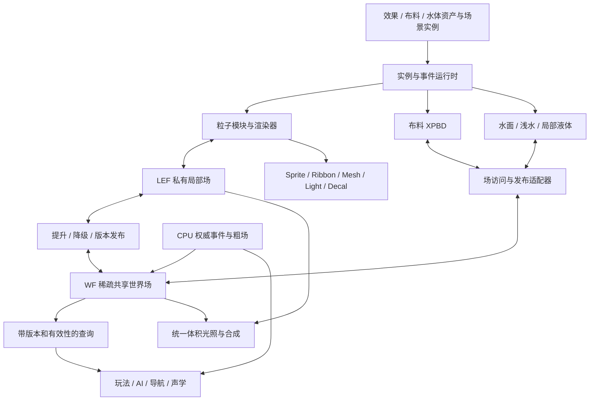

# 粒子、共享场、布料与水：完整开发方案

- 日期：2026-10-22；版本：设计 v1.0。
- 基线：NativeGPU 0.11.0，Windows / D3D12，Web/Electron 编辑器与独立原生预览。
- 状态：实施中，逐包证据见 [开发记录](SIMULATION-DEVELOPMENT.md)。本文描述完整目标；未被开发记录及实测证据确认的接口、性能数值和验收阈值仍为设计，不代表已经实现。
- 目标：交付可以制作、组合、调试、发布游戏效果的系统，覆盖常见粒子效果、共享空间查询、环境与角色布料、池塘/河流/海面及局部液体。
- 场的概念依据：[FIELD-PLAN.md](FIELD-PLAN.md) §4–9。保留“共享空间数据底座、LEF/WF 两级场、通道租约、可观察性驱动提升/降级、分层确定性”；本文补充可实施合同，并扩展其粒子创作和布料/水适配范围。
- 相关：[体积渲染](VOLUMETRICS-PLAN.md)、[光照质量](LIGHTING-QUALITY.md)、[材质管线](MATERIAL-PIPELINE.md)、[动作与软组织](ANIMATION-M1-M4.md)、[物理](PHYSICS-DESTRUCTION.md)、[预算](BUDGET.md)、[编辑器](EDITOR.md)、[确定性](DETERMINISM.md)。

## 1. 完成的定义与产品边界

“开发完整”指有明确支持范围的游戏生产版本：功能、作者工作流、资源生命周期、回退、性能和发布证据全部交付。不能以一个篝火、一个飘旗或一个水面演示代替系统完成。

| 系统 | 必须交付的生产能力 | 代表效果 |
|---|---|---|
| 粒子 | 多实例、多发射器、属性/曲线、事件组合、六类渲染器、热重载、预算、编辑与打包 | 枪口焰、命中、血花、爆炸、烟火、雨雪、落叶、刀光、魔法 |
| 场 | 按区域/通道分配、稀疏 WF、私有 LEF、提升/降级、版本查询、一致性与玩法权威副本 | 烟遮挡、热区、风、湿润、流速、导航成本、声学介质 |
| 布料 | 离线约束烘焙、环境/蒙皮布料、风、碰撞、自碰撞、LOD、材质、编辑与存档策略 | 旗帜、棚布、窗帘、披风、裙摆 |
| 水 | 水体资产、表面波浪、浅水交互、海面、局部自由液体、浮力、岸线/水下渲染、湿润联动 | 水井、喷泉、河流、池塘、海岸、尾流、倾倒液体 |

完整版本包含后文 A–G 全部阶段。G 不是无限期的“未来优化”；未完成时只可发布明确标注缺项的阶段版本。离线影视级水体、任意拓扑的连续撕布、织物纤维微观力学、全世界三维液体高精度求解、完整燃烧化学和跨平台 GPU 逐位确定性不在本轮承诺内。

## 2. 当前基础与不能沿用的假设

| 当前事实 | 处理 |
|---|---|
| 单粒子池 65,536 个，粒子结构固定为位置/速度/温度/年龄 | 保留 legacy 回归；新增属性布局和实例管理，不能称现有布局为通用 SoA |
| 单发射器、96³ 稠密体积、烟火求解器和体积渲染 | 迁移为第一个 LEF 后端与 smoke/fire 模板 |
| 整数原子沉积、MacCormack、涡量、黑体色相和时域累积 | 复用算法；补溢出、运动重投影与动态镜头验证 |
| 现有租约仅计数/等级与求解门控 | 重构为真正的区域资源所有权、按需分配与一致性调度 |
| 粒子碰撞最多 32 个 AABB，网格流体缺完整固体边界 | 加空间索引、SDF/高度场、障碍速度和流体边界；移除单一固定全场上限 |
| 布料只有静态棚布贴图/盒体；局部四面体软组织不是布料 | 建立三角膜布料求解器；只复用形变上传与骨骼碰撞入口 |
| 水只有静态噪声贴图和不透明薄盒体 | 建立独立水体几何、求解、查询与渲染 |
| 场景热重载会重初始化玩法；尚无通用效果状态迁移 | 定义效果局部热重载，不把现有场景重建当成无缝参数编辑 |
| 场景 query 是离线结构查询 | 增加运行时场查询桥；不在纯函数 queryScene 中隐式读 GPU/进程 |
| 体积雾已有后续质量实现，历史方案有过期状态表 | 以实际代码/新证据为准；接入现有 froxel，避免重做历史阶段 |

实现前 A0 冻结 source hash、构建来源和能力矩阵。当前工作区已有大量修改，开发时不得覆盖无关工作。本文不把旧 NEXT-PHASE 的 0.3.0 状态作为当前基线，也不自动调整项目总路线。

## 3. 总体架构：共享数据，独立求解



场保存可采样的连续空间量及其版本，不接管角色、门、任务等离散对象。水体 ID、布料 ID 和发射器 ID 属于对象系统，不能编码成随意插值的标量通道。事件组织爆炸的冲击、火球、碎屑、声音、贴花；场传播和提供空间量。

布料自己的顶点/约束、水的高度网格/液体粒子、光照的探针布局都可保留。只有需要共享的量通过适配器发布到场。空间分辨率不同，要求有版本和误差合同，不要求所有消费者持有同一物理纹理。

## 4. 场核心：把新概念落成可执行合同

### 4.1 两级数据与所有权

- **LEF**：效果私有，可选稠密或砖块后端，拥有高频细节与局部求解。小火星、刀光、雨滴可完全不申请 LEF。
- **WF**：全局稀疏、分层分辨率，提供多消费者共享的低频空间状态，不因看见一个小火苗就把整个世界细分。
- **CPU 权威粗场**：属于 WF 的玩法层，由固定 tick 的权威事件/几何/CPU 求解更新。GPU 视觉只读或派生，不能把非确定性 GPU 结果回读成权威玩法输入。
- 每个通道声明单位、坐标系、数据域、默认值、owner、写入规约、插值/限制方法、衰减规则、依赖和误差界。`heat` 迁移为明确的 `temperatureKelvin`，不能把现有无量纲热量直接当 Kelvin。

| 通道组 | 示例 | 权威与共享规则 |
|---|---|---|
| 视觉介质 | density、temperature、velocity、fuel | GPU LEF/WF；可查询但显式非确定性 |
| 玩法介质 | smokeOpacity、hazard、navCost、occlusion | CPU WF；固定 tick、稳定整数/定点规则 |
| 环境驱动 | windVelocity、moisture、surfaceHeat | 按消费者需求分配；风与水流明确不同通道 |
| 水域投影 | waterHeight、waterDepth、waterVelocity、foam | 水求解器拥有原始数据；WF 提供有界投影与查询适配 |
| 布料反馈 | coarseOcclusion、airDrag、wetnessSource | 只发布有消费者的粗代理，不向 WF 写全部顶点 |
| 光照/声学 | irradiance、soundMedium | 独立 owner；场不替代 GI、声传播算法 |
| 调试 | provenance、lastWriter、overflow、errorBound | 调试档按需租用 |

温度合并需按热容量/质量计算，速度需明确质量加权或 owner 覆盖；密度使用可加贡献，遮挡使用规定的覆盖规则。法线、类别、导航成本不能一律用三线性插值。通道之间的必要关联由组合算子定义。

### 4.2 租约与按需分配

提议接口：

```cpp
FieldLease acquire(FieldRegion region, ChannelSet channels,
                   FieldLevel level, UpdateRate rate,
                   ConsistencyRequirement consistency, FieldBudget budget);
FieldSample sample(FieldLease lease, Position p, QueryTime time);
void release(FieldLease lease);
```

租约包含 owner、读/写权限、区域、分辨率、更新频率、最大陈旧 tick、优先级和资源预算；句柄含 generation。申请返回 accepted / partial / rejected 与实际覆盖，不能静默把 Strong 降为 Stale。

无租约通道不提交物理页、不调度；预留地址空间不算已分配。多个租约共享覆盖页；最后引用释放后等待在途 fence，再回收页和描述符。跨帧渲染快照持有读取租约，防止读到已复用内存。

### 4.3 稀疏砖块与数值边界

- 初始候选 16³ 内部体素砖块；需要相邻采样的算子带一层 halo，分配和预算按 18³ 实际尺寸核算。
- GPU 页表、按通道 SoA 池、空闲表、活跃/脏砖列表、版本/代际、分辨率层级与页缺失位图。
- CPU 使用稳定砖坐标编码和确定顺序遍历。GPU 活跃列表顺序不进入玩法摘要。
- 负坐标、跨砖插值、LOD 接缝、世界原点平移均有定义；缺页返回 valid=false 或声明的边界值，不自动把未知区域当空气/无危险。
- 场景障碍先构建几何 SDF/占据代理；流体边界施加固体法向速度约束。压力算子、散度和梯度使用一致离散；跨砖 halo 同步后才迭代，不能各砖独立投影导致接缝泄漏。
- 以稠密双精度/高精度小网格作数值参考，先验算子再接稀疏寻址。压力 residual 和投影前后散度必须进入报告。

### 4.4 可观察性驱动提升/降级

提升触发沿用原方案：浓度阈值、消费者订阅、worldVisible。距离镜头只影响视觉质量，离屏玩法危险不能被删除。

状态机：`LocalOnly → PromotePending → Shared → DemotePending → LocalOnly/Retired`。提升和降级阈值分开，带最短驻留与迟滞；订阅风暴使用配额和稳定优先级。

**共享默认采用“低频投影 + 局部细节”**：LEF 保留求解所有权，WF 保存带 sourceId/epoch 的投影贡献。一个源每版本只贡献一次，重发是替换而非累加；效果结束后撤销该源贡献或按声明衰减。WF 聚合使用分源页或可重建源账本，不能通过减去已截断/饱和数值恢复旧状态。

渲染根据覆盖遮罩从 LEF 或 WF 取同一源的介质，避免同一烟柱计算两次消光。真实求解所有权迁移是独立操作：版本屏障、守恒重采样、接管确认、最后撤销旧 owner；不得与“发布投影”混为一谈。

降级只撤销无需共享的投影，不删除仍被玩法订阅的权威数据。发生预算不足时，拒绝新视觉效果/降低视觉分辨率，优先保证权威层覆盖。

### 4.5 一致性与调度

| 等级 | 合同 | 超时处理 |
|---|---|---|
| Strong | 查询指定 simulationTick 的已提交权威版本 | 预留 CPU 预算；无法满足返回 unavailable，玩法采用明确保守策略 |
| Eventual | 在租约 maxAgeTicks 内返回可用版本 | 提升调度优先级；超期标记 stale，不能伪装成功 |
| Stale | 允许陈旧，仅表现使用 | 可延迟、丢细节或回退 |

调度顺序：权威 tick 提交 → 采集租约/脏区 → 稳定预算决策 → solver DAG → halo/依赖 barrier → LEF/WF 发布 → 消费者查询 → 渲染。CPU/GPU 用版本和 fence 对接，Strong 不通过主线程等待 GPU 达成。

独立通道分别记录 sourceTick、publishTick、version、coverage、validity、age、errorBound。跨通道联合查询指定快照组，避免温度来自 t、流速来自 t+4。消费适配器分别接 AI 视线、导航脏区、声学介质、GI 脏区与材质湿润，不宣称场本身实现完整 AI/导航/声学。

### 4.6 确定性修正

整数原子只保证**相同量化贡献集合**的累加与线程顺序无关，不保证浮点粒子运动、量化前输入、GPU 流体求解或最终图像逐位一致。CPU 权威场直接由确定性输入生成；“GPU WF 汇总后再 CPU 化”不足以建立确定性。

定点比例/指数在一轮归约前固定。先证明最大贡献数和动态范围，再做整数归约，最后统一钳位；带正负贡献时不能逐次饱和加法，以免顺序影响结果。64 位原子仅在能力验证后启用，否则分块归约。溢出、丢失贡献和量化误差分别计数。

玩法场、租约权威决策、随机流、CPU 水状态进入 digest/存档。视觉场默认可由 seed+事件重建；精确 GPU 快照是可选缓存，不承诺跨设备重现。GPU 视觉碰撞事件不得直接触发权威伤害。

## 5. 完整粒子系统

### 5.1 资产与实例

`effects/*.effect.json` 包含 schemaVersion、依赖 hash、seed 策略、bounds、LOD、emitters、modules、renderers、events、预算及回退引用。场景只保存 effectRef 和有类型 overrides；实例有稳定 ID、local/world space、父节点/骨骼挂点和 generation。

发射支持点、球、锥、盒、线、网格表面；rate、burst、距离发射、预热、循环、延迟、暂停、变速与终止。随机种子由资产/实例/发射序号派生，不依赖渲染帧率。确定性生命周期时间以 tick 表示。

编译期计算属性 SoA 布局，按效果选择 position、velocity、age、lifetime、color、size、rotation、mass、temperature、ribbonId 等属性。模块声明读写和顺序，拒绝未初始化属性/循环依赖；不允许每帧动态改变 stride。

### 5.2 模拟与绘制

- CPU 负责实例、权威事件和少量交互粒子；GPU 负责视觉粒子。支持 alive/dead 列表、紧致、分组派发和 ExecuteIndirect；不为每个视觉实例每帧同步回读。
- 位置/速度/颜色/大小曲线，阻力、重力、吸引、旋转、curl noise、风/流场采样；温度和密度写场是可选模块。
- 深度碰撞用于廉价屏幕特效；SDF/高度场/刚体代理用于离屏连续场景；高速粒子做扫掠检测。碰撞空间索引与查询容量有上限和拒绝报告。
- Sprite：朝向、轴锁定、速度拉伸、flipbook、软粒子；Ribbon/Beam：轨迹、稳定连接、断点、UV；Mesh：实例网格与旋转；Light：受现有灯光预算约束；Decal：投影、寿命与回收；Volumetric：注入 LEF/WF。
- 透明路径明确 additive / premultiplied alpha / cutout；alpha 粒子做视深排序，OIT 为可选质量档并注明近似；限制 overdraw，不能只以粒子数量衡量成本。
- 光照档分 unlit、lit、近似体积；同一效果不能靠不透明材质 alpha=1 代替正确混合。

### 5.3 事件组合

事件包括 spawn、collision、death、threshold、timeline marker。带 sourceId、tick、sequence、位置、法线、能量、可靠性类别。

CPU 权威事件保证固定排序和一次消费；GPU 视觉事件通过有界异步队列生成火星/声音等表现，记录延迟与溢出。子效果设深度、每 tick 数量和总存活预算，禁止递归风暴。完整爆炸资产组合冲击、火球、烟、火星、碎屑、光、贴花和声音。

## 6. 烟火与统一体积

保留现有烟火算法，改为独立 SmokeFireSolver：速度/压力与标量状态分离，按需租用 fuel、temperature、density；压力/散度/旋度是局部求解临时通道，无消费者时无需提升到 WF。

补充固体边界、移动障碍速度、可选燃料消耗与点火/熄灭的游戏近似、上限约束与稳定子步。燃烧参数声明为艺术可控近似，不宣称完整化学。

体积合成统一接现有 froxel/光照服务。明确介质合并顺序、消光系数和发射单位，雾、云、烟不得重复积分。近景 LEF 可用细节 ray march，但应在统一深度区间合成，不能简单在最终图上重复叠一层烟。

时域增加相机重投影、前帧深度、介质版本与速度辅助、邻域限幅、遮挡/显隐/切镜历史拒绝。转头、移动烟、突然爆炸与切镜均须动态视频/序列证据。热浪使用温度梯度驱动屏幕折射，离屏与无颜色缓存时有回退。

## 7. 布料系统

### 7.1 资产与烘焙

`*.cloth.json` 引用模拟三角网格、渲染网格、骨骼绑定与材质；烘焙 rest position、质量/面积、拉伸/剪切/弯曲约束、固定/附着权重、缝合边、碰撞厚度、约束着色分组和 LOD 映射。记录长度 m、质量 kg、刚度/顺应度单位、版本及 hash。

支持环境布与蒙皮衣物；模拟网格和渲染网格分离，以稳定三角重心映射传递形变。拒绝退化面、非法权重、非流形缝合和反向映射。切线、UV 接缝、双面法线需要渲染资产路径先行支持。

### 7.2 求解与接触

采用 XPBD 三角膜路线，含面内拉伸/剪切、二面角弯曲、附着/最大位移约束、阻尼、重力与气动力。先做 CPU 小网格参考，再做 GPU 分组无写冲突约束；GPU 不承诺玩法确定性。XPBD 选型依据见 §15；不能把子步和迭代误差解释为已消失。

骨骼求值后更新附着目标和扫掠胶囊/球，布料求解后输出形变与法线/切线，最后绘制。显式区分绑定空间、骨骼空间和世界空间，避免 soft delta 与布料位移叠加两次。

场景接触支持平面、球、胶囊、OBB、SDF；高速角色采用连续/扫掠接触与子步。自碰撞采用空间哈希的点-三角和边-边候选、相邻拓扑过滤、厚度与摩擦；高质量档增加连续检测。自碰撞关闭是明确 LOD，而非对衣物默认隐去。

### 7.3 场耦合与产品行为

读取 windVelocity、temperature、moisture、水体表面与流速；风压按相对速度与三角面积计算。湿润影响质量、阻尼与材质；受热/浸水采用有界模型。默认布料单向接收风，双向空气阻力只在 G 阶段受预算的粗代理启用。

布料与刚体可有界反馈冲量，但装饰布料不能改变权威角色移动。需要阻挡/伤害的帆布、帆等使用 CPU 权威代理，视觉布料跟随。

支持休眠、传送重置、暂停/单步、挂点移动、骨骼高速转动、LOD 渐变、离屏降频和恢复。LOD 不丢固定点；切换插值位置与速度避免能量爆发。衣物穿插提供厚度/碰撞视图，不能只靠放大角色隐藏问题。

材质增加双面正确法线、织物 sheen、经纬方向粗糙度/法线、湿润参数；先完成 UV/tangent 资产与所有绘制路径一致性，再验收织物着色。破损首版用预切片/预烘焙断边，任意动态切割另立范围。

## 8. 水系统：分层求解，共享查询

### 8.1 四种后端全部纳入完整版本

| 后端 | 场景 | 状态与限制 |
|---|---|---|
| 解析表面 | 井、池塘、远景水 | Gerstner/解析波与动态法线；不模拟真实流体体积 |
| 2.5D 浅水 | 河流、岸边、脚步涟漪、尾流、局部淹没 | 高度/水深、水平动量、地形；无法表示同一点多层水或翻卷破波 |
| 频谱海面 | 开阔海与海岸远景 | 多级 FFT 频谱与非重复采样，近岸交互叠加浅水；不等价完整近岸破波 |
| 局部三维液体 | 倾倒、容器、喷泉近景、局部飞溅 | PBF 邻域/密度约束与表面重建；独立容量域，不铺满世界 |

不要把烟求解器改个颜色当水。几何水面/浅水状态由 WaterBody 拥有；通过 WaterQuery 和 WF 投影暴露高度、深度、流速、湿润等共享信息。

### 8.2 资产、模拟与查询

`*.water.json` 声明边界、多边形/河道样条、底床引用、水位、流量、波谱、后端、材质、权威模型、预算。水面使用细分网格/clipmap 与保守位移包围盒，移除薄盒体主路径。

浅水采用守恒有限体积离散，明确静水保持、正水深、干湿边界、CFL 子步、入流/出流、障碍与源汇；统计数值质量误差。超出稳定步数时报告并降低视觉分辨率/速度档，不能跳过权威时间。

CPU 权威高度/流量可采用解析或粗网格，固定 tick 和确定边界输入；GPU 细波只影响表现。浮力查询返回 height、normal、velocity、depth、waterBodyId、tick、validity 与误差范围。水体重叠有明确选择规则，未知区域不能默认无限水深。

浮力/阻力通过现有刚体力/冲量接口接入，多点采样估计排水体积；CPU 权威刚体向 CPU 粗水模型投影排水/动量，GPU 接收相同事件细化尾流。双方反馈有固定顺序、限幅与能量诊断，不能靠 GPU 回读影响下一帧权威物理。

PBF 使用邻域网格、密度约束、固体 SDF、黏性/涡量近似；自适应子步有上限。表面重建至少提供深度/厚度过滤与法线，验证薄片、容器边缘、离屏回退；高质量可加网格重建。其视觉液滴回落与浅水交换使用源账本，仅转移一次质量/动量；超容量则减少视觉喷溅，不删除权威水量。

### 8.3 渲染与水下

- 专用电介质 Fresnel、能量分配、深度相关吸收/散射、折射、反射、法线多尺度与泡沫。
- 反射质量档：环境贴图 → SSR+环境回退 → 可选平面反射；DXR 反射单列扩展，不作为全平台依赖。
- 折射使用不含当前水面的场景颜色/深度，拒绝采样水面前方几何；前后表面与厚度规则明确。
- 河岸/岸线泡沫、浅滩颜色、接触水花与水位变化；泡沫来源分别是流速/曲率/破碎近似/事件，不能所有边缘统一白边。
- 水下相机判定、吸收雾、体积光近似、进出水过渡；波动水线要稳定，不因镜头贴水闪烁。
- 水、透明粒子、玻璃、烟的绘制顺序和深度合同统一；首版对任意透明互穿保留明确限制与测试场景。

### 8.4 共享场联动

雨滴/水花事件发布 moisture，材质适配器将它映射为局部表面 wetness，并保留遮罩、排水/蒸发和时间常数；不能仅用空气湿度直接把整面墙全部变湿。水接触布料更新湿质量/阻力；火接触水按权威事件熄灭并生成视觉蒸汽。水深/流速对导航和危险区的影响走 CPU WF，渲染泡沫不参与伤害判定。

## 9. 编辑器、脚本与 AI 工作流

沿用 Web/Electron + 原生预览。先提供 schema、CLI 和可热重载资产，再加效果、布料、水体面板；不新建第二套编辑器。基础面板是生产完成项，任意节点脚本编辑器不是本轮前提。

统一流程：选择资产/实例 → 修改草稿 → 校验/成本预估 → 差异预览 → expectedRevision 提交 → 帧边界发布 → 原生截图/序列对比 → 撤销。资产参数热改保留兼容实例；属性布局、布料拓扑、水后端变化需显式重置，失败保留旧版本。

新增工具提议：effect_spawn/stop/set_param/capture、field_sample/inspect_leases/capture_slice、cloth_set_pin/inspect_contact、water_query/set_level。所有写入复用事务服务，运行时命令走单独有记录的控制桥；离线 scene query 不偷偷依赖运行进程。

调试视图含粒子 bounds/alive/overdraw、砖块/租约/owner/version/age、提升状态、权威/视觉差异、布料约束残差/穿透、自碰撞候选、水深/流速/质量误差。字段 unavailable 必须可见。

AI 调参复用这些工具，只能在作者给定参数范围、时长、预算和截图目标内搜索；每次输出参数差异、实际成本和回归结果。自动视觉评分不能取代玩法/数值/资源门禁。

## 10. 资源、性能与回退合同

以下为首轮目标，不是硬件实测。A0 后通过微基准冻结可达档位；发现不可达应缩小负载或调整明确发布档，不在验收失败后偷偷放宽阈值。

| 档 | 标准负载 | 四系统合计 GPU P95 目标 | CPU 仿真/调度 P95 | 增量 GPU 常驻上限 |
|---|---|---|---|---|
| Low / 890M 候选，1080p | 50k 视觉粒子、1 个 48³ LEF、2k 布点、解析水+128² 浅水 | ≤4 ms | ≤1.5 ms | 128 MiB |
| Medium / RTX 5060 候选，1080p | 200k 粒子、4 个 64³ LEF、12k 布点、2×256² 浅水 | ≤5 ms | ≤1.5 ms | 256 MiB |
| High / RTX 5060 候选，1440p | 500k 粒子、8 个 64³ LEF、32k 布点、512² 浅水+256² 海谱；32k 局部液体粒子包含在粒子总额内 | ≤7 ms | ≤2 ms | 512 MiB |

各档还需满足完整游戏帧预算；High 不自动承诺整帧 60 fps。负载明确 alpha overdraw、半分辨率体积、布料子步/自碰撞、WF 活跃砖上限和视口覆盖。PBF 高质量可替换同预算烟场，不能同时无条件叠加所有极限负载。

内存计算按实际格式、halo、双/三缓冲、排序/邻域 scratch、迁移并存、历史图、上传和分配对齐统计。参考：一个 64³ 稠密烟域若有六份 RGBA16F 状态、两份 R32_UINT 源和三份 R32_FLOAT 压力/散度，则净负载约 17 MiB，8 个已约 136 MiB，尚不含 halo/帧副本；不能沿用“每域几 MB”的粗算。

接入现有单调预算阶梯：减少低优先级发射/灯/overdraw → 视觉降频/减子步 → 降 LEF/水面分辨率 → 远处布料烘焙/蒙皮 → 体积烟用序列帧 → 关闭非必要视觉场。各档只能出现实际已实现的回退。

权威 CPU 场、危险区、水位/浮力不得因视觉降档消失。减少分辨率必须重新分配更小资源并 fence 回收旧资源；降低采样精度不算释放显存。记录 downgradeReason、实际节省、queryErrorBound 和 fallbackUsed。

## 11. 实施阶段、依赖与交付

以下为工程估算区间，单位人周，包含该包实现与专项验证；不等于日历承诺。按共享基础只计一次，总计 77–114 人周；另预留 20% 集成/未知项为约 92–137 人周。团队分工可缩短日历，但依赖门禁不能跳过。

| 阶段 | 工作包与交付 | 前置 | 人周 | 退出条件 |
|---|---|---|---|---|
| A | A0 当前能力/时序冻结；A1 仿真时钟、RHI 资源/间接派发/异步队列；A2 资产 schema、依赖与局部热重载；A3 UV/tangent/双面/透明材质前置 | 当前引擎 | 8–12 | 有独立计时、无同步回读派发、非法资产拒绝、资源 fence 验证 |
| B | B0 通道注册/合并；B1 区域租约/页池；B2 LEF 迁移；B3 稀疏 WF/halo；B4 提升/降级；B5 CPU 权威场/查询/回放 | A | 15–21 | 按需分配、跨砖正确、无重复贡献、100 次权威对拍 |
| C | C0 属性/实例/发射；C1 模块/曲线；C2 Sprite/Mesh；C3 Ribbon/Beam；C4 Light/Decal；C5 事件与完整效果库 | A，场模块依赖 B2 | 12–17 | 六类渲染器、组合爆炸、多实例与透明/事件压力通过 |
| D | D0 固体边界/数值残差；D1 smoke/fire 独立 solver；D2 froxel 统一介质；D3 时域/热浪；D4 AI/导航/声学/材质适配 | B；组合效果依赖 C | 9–13 | 动态镜头稳定、消费查询有版本/误差、显隐一致 |
| E | E0 布料 cook/映射；E1 CPU XPBD 参考；E2 GPU 约束/碰撞；E3 自碰撞/CCD；E4 衣物/LOD/湿润/材质 | A；环境耦合依赖 B | 12–18 | 环境与角色布料、穿透/拉伸门禁、传送/LOD/存档策略 |
| F | F0 水资产/解析面/查询；F1 浅水/CPU 权威；F2 浮力/双向粗耦合；F3 光学/水下；F4 FFT；F5 局部 PBF/重建/质量交换 | A、B；喷溅依赖 C | 15–23 | 四后端、水下/浮力/质量与湿润联动全部通过 |
| G | G0 三类创作面板与场调试；G1 跨域有界反馈；G2 所有效果库/性能/发布门禁与工具文档 | B–F | 6–10 | 制作者可独立制作/保存/复用/发布，完整联合场景通过 |

推荐执行顺序：A → B0/B1/B2 + C0/C1/C2 → B3/B4/B5 → C3–C5 + D → E + F → G。表中可独立推进的工作只是团队排期建议，不表示当前已创建并行开发任务。

每个工作包先提交契约/失败行为与最小测试夹具，再实现，再生成证据与状态更新。G 的面板可从 A2/C0 起增量建设，不拖到最后才发现资产不可编辑。

阶段发布：R1=A+C 基础粒子，R2=B+D 共享场/烟火，R3=E 布料，R4=F 水，R5=G 完整生产版。各阶段保留上一可运行版本和对应资产迁移器。

## 12. 验收矩阵与阈值

阈值限定于固定资产、尺度、输入和测量区间。A0 冻结夹具与测量方法；超出该范围需补新测试，不泛化承诺。效果开关只能证明实现有影响，不能证明数值或视觉质量正确。

| 类别 | 固定测试与门槛 |
|---|---|
| 场生命周期 | 10,000 次区域租还；结束并排空 fence 后 live pages/leases 回到基线；无租约通道 committedBytes=0 |
| 稀疏寻址 | 负坐标、跨砖/跨 LOD、原点移动与缺页；对参考密度采样最大绝对误差 ≤1e-3（归一化测试域） |
| 整数沉积 | 相同贡献集合随机排列 100 次哈希一致；正常范围零溢出；误差 <0.5%，近零值用固定绝对误差门槛 |
| CPU 权威 | 同输入 100 次 digest 一致，存档继续与未中断 tick 摘要一致；视觉质量切换不改变摘要 |
| 提升/降级 | 预算内 Eventual 发布 ≤3 个渲染帧；超预算返回 overdue；重复事件不重复贡献；源停止后无残页 |
| 守恒迁移 | 封闭合成密度源重采样总量误差 ≤1%；覆盖遮罩无双重积分；超量/缺量单独计数 |
| 一致性 | Strong 对指定 tick 返回或明确失败；Eventual age≤租约门限，否则 stale；不存在无标记过期样本 |
| 流体投影 | 固定可解小网格投影后散度 L2 降低 ≥90%，报告压力 residual；稀疏结果对稠密参考容差单列 |
| 粒子 | 128 个混合实例反复 spawn/stop；计数/随机流正确；子效果风暴受限且可诊断；不同渲染 fps 的 tick 发射数一致 |
| 布料 | 1m 方布/固定材质：稳定期边长相对误差 P95≤5%；角色夹具接触穿透 P99≤2mm、最大≤10mm；报告持续时间而非只测一帧 |
| 自碰撞 | 折叠布和披风急转；持续超过 2 tick 的非邻接面穿透不允许；CCD 与离散档分别报告 |
| 水守恒 | 封闭 10m 浅水池 60s，扣除声明源汇后质量误差 ≤1%；静水高度漂移 ≤1mm；水深非负、无 NaN |
| 浮力 | 规定密度盒体静水平衡浸没体积误差 ≤5%；报告阻尼/稳定时间与 CPU/GPU 表面高度偏差 |
| 局部液体 | 封闭容器不丢粒子；已知源汇质量账本一致；32k 夹具密度残差 P95≤5%，邻域溢出为零 |
| 视觉 | 固定机位参考、顺/逆/侧光、白天/夜晚、动态转头/切镜、透明互穿；截图阈值逐场景冻结，动态序列检查拖影/闪烁 |
| 性能 | 固定驱动/硬件/分辨率，预热 10s、采样 60s，记录独立 compute/graphics P50/P95/P99 与队列等待；不能将重叠 pass 耗时直接相加当整帧耗时 |
| 稳定性 | 30min 混合场景，热重载/暂停/传送/质量降档/设备重建，无 NaN、悬空描述符、持续增长；启用 debug layer 的结果单列 |

图像比较对 GPU 视觉使用容差/时序统计，不要求跨驱动逐位相同；CPU 权威使用精确哈希。参考来自解析解、小规模数值参考或明确的目标图；三张截图彼此不同不能作为“真实感达标”证据。

## 13. 必须交付的效果库与联合场景

至少 16 个可复用粒子资产：篝火、火把、爆炸、蒸汽、灰尘、火星、枪口焰、命中火花、血花、雨、雪、落叶、刀光、弹道尾迹、魔法光束、落水水花。每个含参数说明、成本、LOD/回退和原生截图；有事件的效果含时间序列。

布料库：旗帜、棚布、窗帘、披风、裙摆，覆盖不同密度/刚度/厚度与固定点。水库：井水、池塘、河道、海岸、容器倾倒、交互喷泉，四种后端均有独立资产。

联合场景“暴雨中的河岸营地”：雨/风驱动旗布与披风，湿润改变布料和地面；角色踩水产生涟漪/水花；浮箱受流；火遇水产生蒸汽/熄灭；烟遮挡 AI 并更新导航/声学介质；远近镜头触发 LEF/WF 提升、LOD 和预算降档。

验收需说明每个联动是视觉还是权威、谁写哪个通道、查询 tick/延迟、谁拥有质量/能量。关闭 GPU 细节后，危险区/浮力/水位等玩法结果仍一致。单项全通过但联合场景失败，完整版本不得标为完成。

## 14. 文件落点与执行清单

提议目录，实施时按实际项目组织调整：

```text
engine/native/fields/      registry / lease / sparse / snapshot / authority / adapters
engine/native/effects/     asset / instance / modules / events / curves
engine/native/cloth/       cook_contract / solver_cpu / collision / embedding
engine/native/water/       body / query / shallow_cpu / buoyancy
renderer/fields/           page_pool / halo / scheduler / transfer
renderer/effects/          simulate / indirect / renderers
renderer/cloth/            solver_gpu / deformation
renderer/water/            shallow_gpu / spectrum / pbf / surface
shaders/fields/ effects/ cloth/ water/
tools/offline/             effect-cook / cloth-cook / water-cook
assets/effects/ cloth/ water/
editor/                    对应资产面板与场调试视图
tests/                     资产/数值/权威/生命周期/图像合同
tools/                     effects / fields / cloth / water / simulation-suite 验收入口
```

扩展 host loader、scene schema、Node validator、事务服务、RHI、回放/存档和 package 工具时保持三端合同一致。所有 CLI/工具命令在真正落地前均标为 proposed，不提前加入 package.json 的可用脚本。

每包完成记录：源码/着色器/工具链 hash、资产 hash、硬件/驱动、实现状态、回退原因、测试命令与结果、数值误差、独立耗时、内存、截图/序列、已知限制。报告保存到 `reports/<version>/<commit>/<timestamp>/simulation/`；latest 只做索引，不覆写历史失败。

Definition of Done：资产可验证和打包；运行时实际执行；编辑/脚本可调用；异常与预算可解释；无资源泄漏；专项与既有回归通过；证据与文档齐全。capabilityAvailable、implemented、active、fallbackUsed 分别记录。

## 15. 技术参考与决策边界

以下为本方案查阅的原始资料；具体工程架构、预算、工期和阈值是本项目设计，不是论文给出的性能保证。集成任何第三方代码前核对具体版本的许可证、依赖、hash 与现有 TOOLCHAIN；本文没有授权自动替换既有刚体后端或引入所有候选库。

- [XPBD，Macklin 等，2016](https://matthias-research.github.io/pages/publications/XPBD.pdf)：布料约束求解的理论依据。项目仍需自己的碰撞、资产、并行和 LOD 工程。
- [Position Based Fluids，Macklin/Müller，2013](https://matthias-research.github.io/pages/publications/pbf_sig_preprint.pdf)：局部三维液体候选；本文不直接采用论文示例的性能数字。
- [GPU Gems 3：实时三维流体](https://developer.nvidia.com/gpugems/gpugems3/part-v-physics-simulation/chapter-30-real-time-simulation-and-rendering-3d-fluids)：烟/液体求解、障碍和渲染的实现参考。
- [GPU Gems：水面模拟](https://developer.nvidia.com/gpugems/gpugems/part-i-natural-effects/chapter-1-effective-water-simulation-physical-models)：解析几何波与细节法线组合参考，不代表浅水守恒求解已被覆盖。
- [OpenVDB 官方文档](https://www.openvdb.org/documentation/)：离线交换和稀疏数据参考；运行时是否复用 NanoVDB 必须验证可变拓扑、写入和分配需求，不能仅因能 GPU 采样就认为租约/迁移已解决。

优先验证风险：B 的贡献所有权与稀疏边界、E 的自碰撞、F 的干湿边界与 CPU/GPU 水面偏差、D 的透明/体积合成、G 的混合负载。每项先建最小数值/视觉夹具；风险实验不通过时保留明确阶段版本，不能以静态贴图替代后宣称完整模拟。
