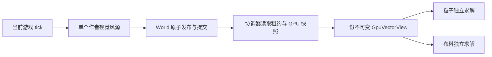

# 宿主共享风场与独立消费者

2026-10-24，B/E/C 的宿主联动增量。原 A–G 目标保持 active；本页描述已经实现的作者风轨道与只读 GPU 快照链路。

新增 `--simulation-field <*.field.json>`。同一份 `windVelocity` 既可以供独立环境布料使用，也可以供 GPU 粒子与布料同时使用。它只支持 `domain=visual` 的风轨道，不能把作者文件当作 Game 的 CPU 权威风场。粒子须声明 worldVisible 场、风通道及匹配的米制网格；无消费者、CPU 粒子、只有 waterVelocity 的输入、与旧 `--effect-field` 同时配置均明确拒绝。



`Renderer::configureSimulationFields` 和 `GpuFieldFrame` 独立于粒子实例。`gpu_field_bridge.cpp` 在任何消费者运行前创建/记录场服务，设备重建时保留配置和驱动、重建页缓存与 GPU 绑定。释放顺序是完成实际队列 → 布料/粒子消费者 → 场绑定/页缓存。旧 `configureGpuEffectFields` / `--effect-field` 继续使用原先显式的粒子字段时钟与调用接口。

## 时间、所有权与退出

`host::SimulationFields` 持有一个向量作者源，协调器替已注册消费者聚合读取兴趣。一个 CPU 写租约、一个协调器读取租约；GPU 缓存只有一个空间读取租约。每个向量分量各有一条源账本记录，因此报告通常是 **2 个 CPU 租约、3 条标量源记录、1 个 GPU 读取租约**，不是三份风源。粒子、任意数量布料共享同一不可变视图，没有按消费者重复累加或重新提交源。

采用明确的视觉时间规则：每次原生帧记录前，在**当前游戏 tick** 求值并提交作者风，供该帧所有视觉追赶步使用。查询 tick 保存在视图中，消费者分别保留自己的年龄、暂停/reset 状态。它不是逐个错过的游戏 tick 重放天气，也不承诺视觉结果进入玩法摘要。相同游戏 tick 的重复帧重用已有绑定，不重复提交。向后时间拒绝；撤销后不能修改已提交 tick，重新订阅须使用更新的可提交游戏 tick。

粒子最后退出且没有布料或待发重复效果时，协调器撤销读取租约和作者源，停止提交 GPU 快照。各旧视图仍由实际使用 fence 保护，完成后回收页、上传资源和绑定元数据。粒子停止但布料仍存在时继续订阅，避免过早删除风。暂停布料仍是已注册消费者；设备恢复保留作者源时钟，重新获得 GPU 读取租约。GPU 发布准入失败后重试同一 tick 不重复增加 CPU 源贡献。

## 布料后绑定与回退

`GpuParameters.reserveWindField=true` 在创建时准备场查询管线，随后可 `bindWindField` / `clearWindField`。清除会在下一有效步清掉空间风安装标记，恢复声明的均匀风；解绑不重置场时钟。未预留能力的普通 solver 拒绝临时升级，不隐式创建额外 GPU buffer。

普通求解/初始化使用 56 DWORD 的普通 root signature；只有 SampleWind 使用带元数据 CBV 与直接索引描述符堆的 58 DWORD 变体。采样结束后恢复普通绑定。这样尚未绑定场的初始化和解绑后的运行都不依赖虚假描述符堆，也不增加占位 heap。

原整布提交合同保持：任一顶点查询不可用/过期时，不部分替换旧样本；初次未知或传送清除后使用声明的均匀风。`sharedWindBound=true` 只表示存在查询绑定，不代表每个顶点都有有效覆盖。细分拒绝原因仍在 GPU diagnostics；本批没有新增同步回读，完整宿主异步诊断/编辑器视图仍需后续完成。

## 使用与增量测试

```powershell
npm run fields:shared-wind -- -Adapter AMD
npm run fields:simulation
```

两者可加 `-SkipBuild`，严格校验旧构建的源码/二进制哈希。前者验证真实 GPU 租约缓存上的协调器时钟、重用、撤销、重订阅、恢复和发布失败重试；后者构建独立 `build/cloth-fields-host` 宿主，并在测试前冻结源码/可执行文件，再运行本功能相关场景。标准构建只登记新目标；本批没有执行 `npm test`、`npm run verify`、完整 native/JS/CI 或全量回归。

生成专项夹具后可运行：

```powershell
build/cloth-fields-host/NativeGPU.exe --cloth flag_banner --cloth-library build/simulation-fields/cloth/library.json --simulation-field build/simulation-fields/fixed.field.json
```

再加入 `--effect wind_drift --effect-backend gpu --effect-library build/simulation-fields/effects/library.json` 即共享给两个消费者。中文路径可用。`simulationField` 报告字段源时钟、提交数、租约、摘要和视觉域；`gpuEffects.fields` 继续报告共用服务的实际页/元数据预算，即使没有粒子；`gpuCloth.sharedWindTick` 报告布料使用的明确查询时间。服务可见性不等于粒子已启用。

## 已验证与剩余范围

宿主正式报告：[simulation-fields-evidence.json](../reports/0.11.0/31c00bc53c0b/20261024T041216Z/simulation-fields-evidence.json)，**100/100、22 个运行**。预先冻结 198 项编译依赖和 41 项夹具输入；运行期间源码变化为空。正常场景实际调试层开启、errors=0，玩法摘要与关闭视觉效果的基线一致。

- 独立布料无需 GPU 粒子即可分配/读取场；常量 4 m/s 场与相同均匀风截图一致，零风改变实际形变，覆盖外整布回退与均匀风截图一致。
- 粒子＋布料、两块布料都共享同一生产历史：240 次帧提交、240 个绑定、World tick 480，没有按消费者翻倍。恒定输入下新共享粒子路径与旧字段入口截图一致。
- 只剩布料时继续读取；最后粒子在 tick 30 停止的夹具最终 CPU 租约/源记录/页和 GPU 页、上传、描述符、快照、绑定元数据均为 0，只发布 16 个快照。
- 暂停/恢复、传送到覆盖外、reset、设备重建、中文路径与旧入口释放通过。重建夹具两个字段 epoch，源仍在游戏 tick 480，贡献没有重复提交。

后绑定新增数值专项：[cloth-batch-evidence.json](../reports/0.11.0/31c00bc53c0b/20261024T040311Z/cloth-batch-evidence.json)，**5 组/23123 检查/6760 次顶点采样比较**，位置/速度差 0，完整顶点数据逐位一致，调试错误 0。预留但未绑定、晚绑定、清除、恢复均匀风和原预算/生命周期继续验证；受影响 GPU 求解 7 组/2905 次、绘制与预览时钟 5 组/255 次通过。

协调器专项：[shared-wind-evidence.json](../reports/0.11.0/31c00bc53c0b/20261024T041604Z/shared-wind-evidence.json)，**35 项检查**，实际 GPU/调试层、errors=0。验证零订阅不分配页、同 tick 缓存重用、缺少回调与向后时钟拒绝、恢复不重新提交 CPU 源、GPU 发布失败后重试、最后订阅撤销、无订阅时不发布、禁止修改已提交 tick 和重新订阅。编译输入与可执行文件独立冻结。

保留了两个失败阶段：未绑定时误用直接索引 root 的调试错误在 `reports/cloth-late-binding-unbound-root-20261024/`；宿主初始化丢失新驱动导致 **57/87** 失败的冻结版本在 `20261024T040449Z/simulation-fields-evidence.json`。修复各自原因后重新验证，没有放宽数值或实际调试层门槛。

本批仍是 CPU 作者轨道 → VisualReference World → GPU 只读快照。GPU LEF/WF 写入与所有权迁移、真正的逐 simulation tick 联合调度、温度/湿润/水耦合、Game 权威场与回放、体积、衣物/自碰撞/LOD、完整工具及四系统联合预算验收尚未完成，不能将以上专项作为 A–G 完成证据。
